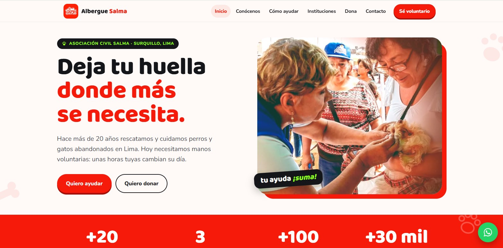

# Albergue Salma – Web de voluntariado

Página web de voluntariado y donaciones del **Albergue Salma de Perritos y Gatitos** (Asociación Civil SALMA, Surquillo, Lima).

- **Web publicada:** https://adr4563.github.io/albergue-salma/
- **Repositorio:** https://github.com/Adr4563/albergue-salma
- **Contacto del albergue:** WhatsApp 999 940 551 · nellygalarza@hotmail.com

Proyecto desarrollado por estudiantes del curso Gestión de Proyectos (Universidad de Lima, 2026-2) como voluntariado para el albergue.



---

## Índice

1. [¿Qué tiene la web?](#1-qué-tiene-la-web)
2. [Tecnologías](#2-tecnologías)
3. [Estructura de archivos](#3-estructura-de-archivos)
4. [Ver la web en tu computadora](#4-ver-la-web-en-tu-computadora)
5. [Cómo actualizar la web (sin programar)](#5-cómo-actualizar-la-web-sin-programar)
6. [Revisión mensual (5 minutos)](#6-revisión-mensual-5-minutos)
7. [Continuidad del proyecto](#7-continuidad-del-proyecto)
8. [Responsables](#8-responsables)
9. [Historial](#9-historial)

---

## 1. ¿Qué tiene la web?

| Página | Contenido |
|---|---|
| Inicio | Presentación del albergue y botones para ayudar o donar |
| Conócenos | Historia de SALMA, la Dra. Nelly Galarza y la labor del albergue |
| Cómo ayudar | Formas de voluntariado, cada una con su botón de WhatsApp |
| Instituciones | Propuesta de voluntariado para universidades, colegios y empresas |
| Dona | QR de Yape y Plin, cuenta BCP y donaciones en especie |
| Contacto | Preguntas frecuentes, horario y datos de contacto |

No tiene formularios ni guarda datos de las personas: todo el contacto es por WhatsApp.

## 2. Tecnologías

Una sola página (`index.html`) sin pasos de instalación ni compilación:

- **React** (vía CDN `unpkg.com`) para la interfaz.
- **HTML + CSS** para la estructura y el estilo.
- **Tipografía Baloo 2** (incluida en `frontend/fonts/`).
- **GitHub Pages** para publicar la web automáticamente desde este repositorio.

No usa base de datos ni backend: toda la información vive en el propio `index.html` y el contacto se resuelve por WhatsApp.

## 3. Estructura de archivos

```
index.html          ← toda la web (textos, secciones y configuración)
README.md           ← esta guía
fotos/               ← imágenes propias (logo, campaña de salud)
frontend/fonts/      ← tipografía Baloo 2
frontend/icons/      ← dibujos decorativos (huellas, huesitos)
frontend/js/app.js   ← motor de la página (no es necesario tocarlo)
```

## 4. Ver la web en tu computadora

No se necesita instalar nada para probar cambios antes de subirlos:

1. Descarga o clona el repositorio.
2. Haz doble clic en `index.html` para abrirlo en el navegador.

   - Si algunas imágenes no cargan al abrirlo así, abre una terminal en la carpeta del proyecto y ejecuta un servidor simple, por ejemplo `python -m http.server`, y luego visita `http://localhost:8000` en el navegador.

## 5. Cómo actualizar la web (sin programar)

Todo se hace desde el navegador, en GitHub:

1. Entra al repositorio y abre `index.html`.
2. Haz clic en el ícono del lápiz (**Edit this file**).
3. Usa `Ctrl + F` para buscar lo que quieres cambiar (ver la tabla de abajo).
4. Cambia solo el texto entre comillas `'...'`, sin borrar las comillas ni las comas.
5. Baja y presiona **Commit changes**.
6. Espera 1 o 2 minutos y recarga la web: los cambios se publican solos.

| Quiero cambiar… | Busca en `index.html` | Qué hacer |
|---|---|---|
| El número de WhatsApp | `const WA =` | Escribe el número con 51 delante y sin espacios, por ejemplo `'51999940551'` |
| Los mensajes que llegan por WhatsApp | `const MSG =` | Cambia el texto de cada mensaje |
| Una foto | `const PHOTOS =` | Sube la foto a la carpeta `fotos/` (**Add file → Upload files**) y reemplaza el enlace por `'fotos/nombre-de-la-foto.jpg'` |
| Los QR de Yape y Plin | `QR Yape` / `QR Plin` | Sube las imágenes a `fotos/` y reemplaza el recuadro por `` |
| La cuenta BCP | `Transferencia BCP` | Cambia los números de cuenta y CCI |
| Cualquier texto | El texto tal como se ve en la web | Reemplázalo por el nuevo |

**Si algo sale mal:** abre **Commits**, entra al último cambio y usa **Revert** para volver a la versión anterior.

## 6. Revisión mensual (5 minutos)

- [ ] Los botones de WhatsApp abren el chat del albergue.
- [ ] Los QR y la cuenta BCP son los oficiales del albergue.
- [ ] Las fotos cargan bien (sin recuadros vacíos).
- [ ] En **Commits** no hay cambios que nadie del equipo haya hecho.

## 7. Continuidad del proyecto

Cuando el equipo de estudiantes termine el curso, la web debe quedar en manos del albergue:

1. **Traspasar el acceso:** agregar a una persona del albergue como colaboradora (**Settings → Collaborators → Add people**) o transferir el repositorio a una cuenta del albergue (**Settings → General → Transfer ownership**).
2. **Seguridad:** quien administre la cuenta debe activar la verificación en dos pasos en GitHub y no compartir la contraseña.
3. **Fotos propias:** algunas fotos todavía se cargan desde la web antigua del albergue (Webnode). Conviene subirlas a `fotos/` para que no dependan de ese sitio.
4. **Dependencias externas:** la web carga React desde `unpkg.com`. Si algún día la página se ve en blanco, revisar que ese servicio funcione.
5. **Difusión:** mantener el enlace de la web en la biografía de TikTok (@albergue.salma), Facebook e Instagram.

## 8. Responsables

| Rol | Persona |
|---|---|
| Desarrollo de la web | Adrian Flores Uzategui (Universidad de Lima) |
| Validación y contenido | Dra. Nelly Galarza Chávez (Asociación Civil SALMA) |

## 9. Historial

| Fecha | Cambio |
|---|---|
| 10/10/2026 | Publicación de la web en GitHub Pages |
| 10/10/2026 | Reorganización del README: índice, sección de tecnologías y guía para verla en local |
